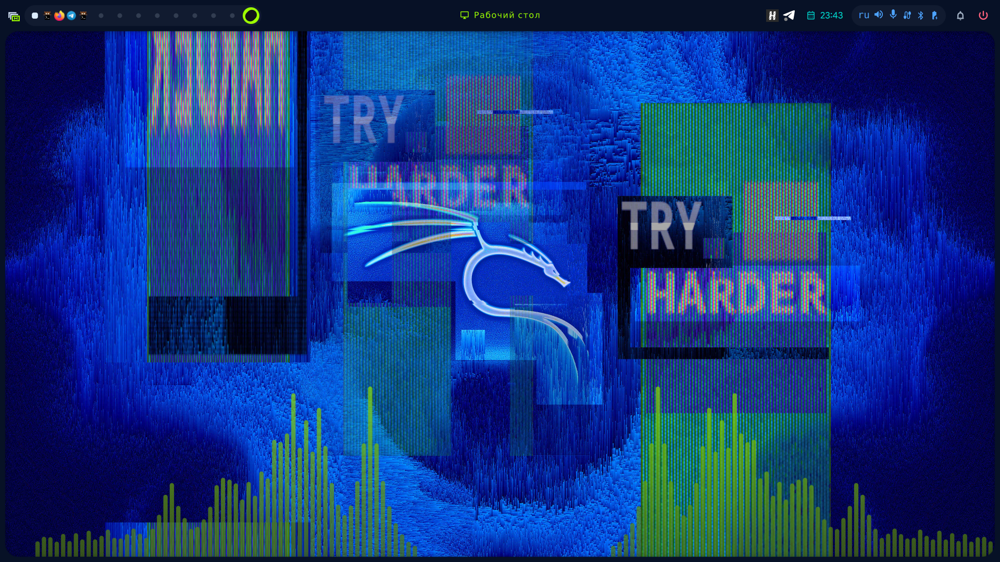
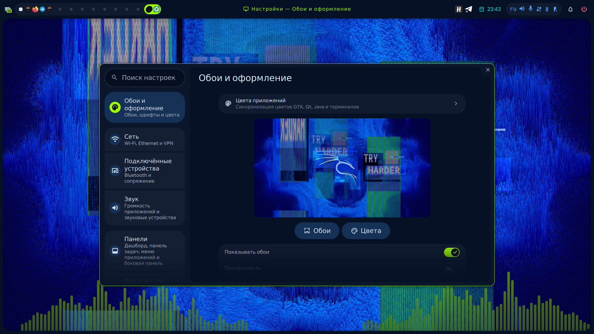

# Kali Linux: experimental installation notes

Tested on Kali Rolling with Hyprland 0.57.1, Quickshell 0.3.2 and Qt 6.11.2.
This is a source-build recipe, not a supported Kali package or a general-purpose installer.

## Compatibility

- Use Hyprland 0.57.0 or 0.57.1 with headers from the same build. Do not bypass the ABI check.
- The tested Kali APT index offered Hyprland 0.56.2, which cannot build the current native plugin.
- For Hyprland 0.57.1, Aquamarine 0.15.1 passed its minimum-version check but lacked `setMaxBpc`. Building Aquamarine commit `ad4484335fc327a6cf010f455ae258c397861ee0`, pinned by that Hyprland release, resolved the mismatch.
- Glaze 7.2.0 was used for the compositor build.
- Install custom compositor dependencies in a private prefix and configure its runtime library search path. Avoid replacing system libraries.

## Build requirements

Translate the Arch dependencies in INSTALL.md to Debian development packages. In particular, the shell needs:

```sh
sudo apt-get --no-install-recommends install \
  build-essential cmake ninja-build pkgconf gettext nlohmann-json3-dev \
  qt6-base-dev qt6-base-private-dev qt6-declarative-dev \
  qt6-declarative-private-dev qt6-shadertools-dev qt6-svg-dev \
  qt6-image-formats-plugins qt6-wayland libqalculate-dev libsensors-dev \
  libpixman-1-dev libdrm-dev libinput-dev libudev-dev libwayland-dev \
  libxkbcommon-dev libpango1.0-dev libcairo2-dev liblua5.5-dev quickshell
```

Review APT's proposed changes before proceeding. Packages built against an older private Qt ABI, such as some NVIDIA Nsight releases, can conflict with the required Qt upgrade.

Building the compositor also requires its own development dependencies. Include `glslang-tools` alongside `glslang-dev`, and `hyprwire-scanner` alongside `libhyprwire-dev`; these separate tool packages were needed during the tested build. Follow the dependency checks in the pinned compositor sources.

With the matching compositor installed and first in PATH, expose its pkg-config directories and follow INSTALL.md's CMake build steps. This fork explicitly locates Lua 5.5 for the native extension, whose headers are in a versioned directory on Debian-derived systems.

## Optional audio analysis

Install `libpipewire-0.3-dev`, `libaubio-dev` and `libfftw3-dev`. A separate libcava development package was unavailable in the tested Kali index. CAVA 0.10.6 provides the seven-argument `cava_init` API used here; newer CAVA releases may change that API. Build the library with position-independent code, expose `cava/cavacore.h` and a `libcava.pc` file, then set:

```sh
-DHYPRSTACK_AUDIO_VISUALIZER=ON
```

Use a fresh build directory when changing this option. An incremental OFF-to-ON build retained stale Qt autogen output during testing and produced a missing AudioCollector vtable at runtime; regenerating the autogen output fixed it.

## Session registration

Copy the configuration and user services as described in INSTALL.md. Create a launcher that prepends the private bin directory to PATH and invokes the matching `start-hyprland`, passing the Hyprstack Lua config.

Register the launcher in `/usr/share/wayland-sessions/hyprstack.desktop`:

```ini
[Desktop Entry]
Name=Hyprstack (Hyprland)
Exec=/absolute/path/to/your/launcher
Type=Application
```

Replace the example path before installing. Do not add a `TryExec` pointing inside a private home directory: GDM's greeter cannot traverse a mode-0700 home and may hide the session. Keep the existing desktop session available.

Install `distribution/defaults/xdg-desktop-portal/hyprland-portals.conf` in the user portal configuration directory, merging with existing preferences where necessary. Keep `xdg-desktop-portal-hyprland` and `xdg-desktop-portal-gtk` installed. The shell provides its own agents; avoid duplicate Polkit agents in this session.

Set both the terminal command in `hypr-vars.lua` and `general.apps.terminal` in `shell.json`. Choose wallpaper through the shell; a plain background before choosing an image is expected.

## Validation and known workarounds

Run `hyprstack-doctor` and `hyprctl configerrors` inside the actual session. Test locking, screen sharing and external outputs separately; a successful build alone does not establish that every integration works.

Telegram Flatpak 7.3.3 crashed when opening a mini app on native Wayland in the tested environment. The same mini app worked with per-application `QT_QPA_PLATFORM=xcb`, `GDK_BACKEND=x11` and the X11 socket enabled. Treat this as an application-specific workaround, not a global session setting.

Telegram's X11 context menu can use the title `TelegramDesktop`. This fork removes unconditional centering from the auxiliary-window rule; the native handler still centers ordinary floating dialogs while skipping override-redirect menus.

Keep local dependency versions pinned when rebuilding. Review upstream updates instead of blindly running the updater against an installation with local source changes.

## Screenshots

Tested Kali session with a blue/lime custom palette and Kali Glitch wallpaper. Wallpaper artwork is supplied by Kali Linux.




